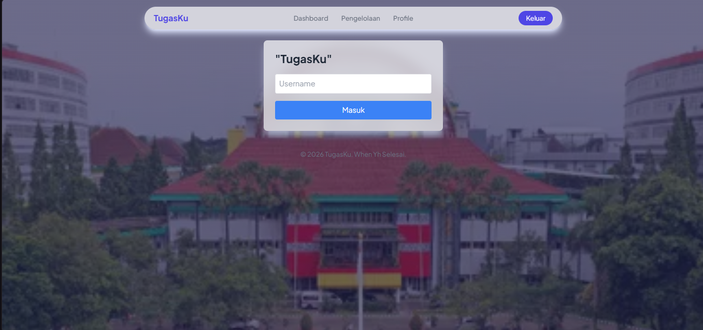
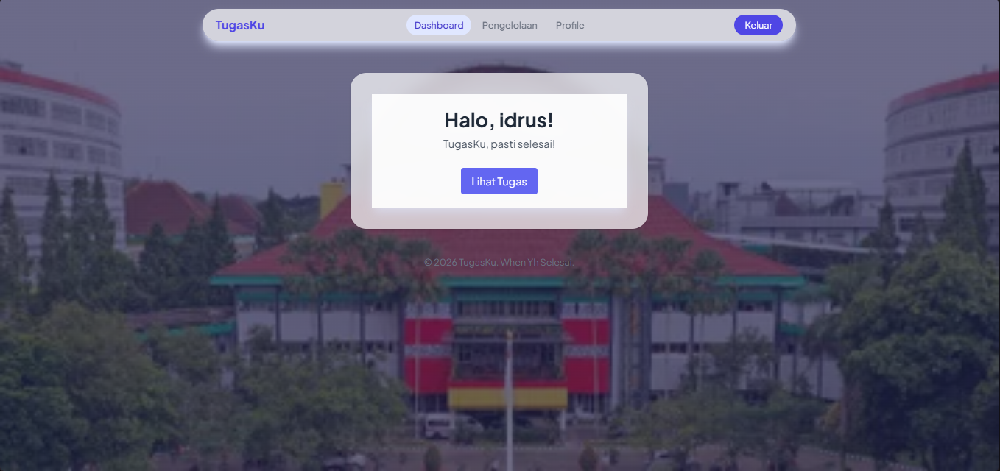
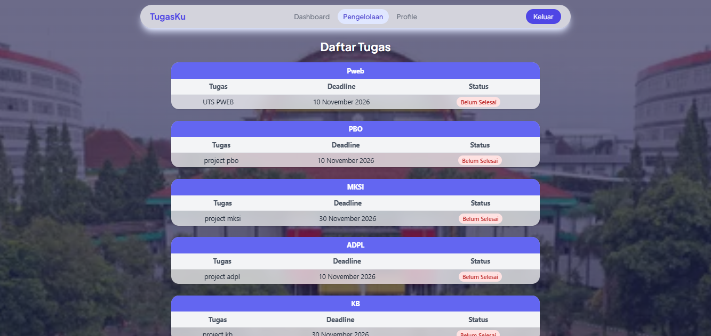
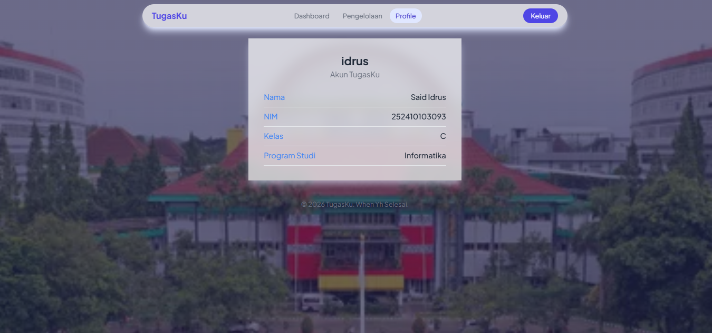

# [Nama Proyek]

[Aplikasi web ini dibuat untuk ... dan dipakai oleh ...]

## Identitas

- Nama: [Said Idrus Abdullah]
- NIM: 252410103093
- Kelas: [Kelas]
- Mata kuliah: Pemrograman Web
- Tugas: UTS

## Fitur

- Login untuk mengakses aplikasi
- Dashboard berisi [isi dashboard]
- Pengelolaan [nama data] ([tambah/ubah/hapus/lihat])
- Profile untuk [melihat/mengubah apa]

## Teknologi

- Laravel [versi], PHP [versi]
- Database: [MySQL/SQLite]
- Tampilan: [Tailwind/Bootstrap/CSS biasa]

## Tampilan Aplikasi

### Login

[halaman awal sebelum memasuki dashboard]

### Dashboard

[halaman awal setelah pengguna menekan tombol login]

### Pengelolaan [Nama Data]

[mengelola deretan tugas yang tercantum, dengan beberapa detail seperti deadlinenya kapan, matkul apa]

### Profile

[pada halaman ini akan ditampilkan profile dari mahasiswa yang menggunakan program ini]

